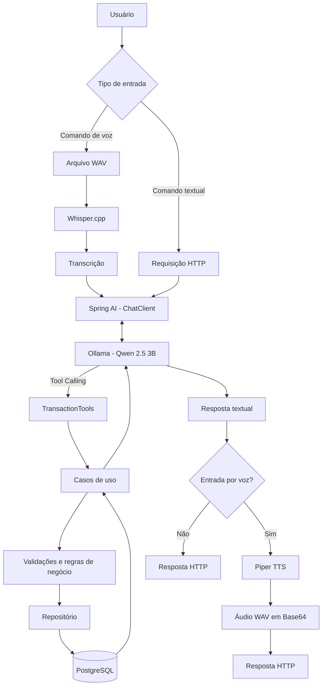

# Voice Budget API

**API REST de gerenciamento financeiro com inteligência artificial local, Tool Calling e interação por voz.**

A Voice Budget API permite registrar e consultar transações financeiras por meio de requisições HTTP, comandos em linguagem natural ou comandos de voz.

A aplicação utiliza **Qwen 2.5 3B**, executado localmente pelo Ollama, para interpretar solicitações em português e selecionar operações por meio de Tool Calling. O Spring AI integra o modelo ao backend, enquanto Java mantém o controle das regras de negócio, validações e persistência.

O fluxo de voz integra reconhecimento de fala com Whisper.cpp e síntese de áudio com Piper TTS, permitindo enviar um comando falado e receber uma resposta em áudio.

O projeto foi desenvolvido como aplicação prática de Java, Spring Boot e inteligência artificial, com foco na integração entre LLMs, ferramentas e operações reais de backend.

## Índice

- [Demonstração da arquitetura](#demonstração-da-arquitetura)
- [Funcionalidades](#funcionalidades)
- [Como a inteligência artificial funciona](#como-a-inteligência-artificial-funciona)
- [Arquitetura](#arquitetura)
- [Tecnologias](#tecnologias)
- [Endpoints](#endpoints)
- [Requisitos](#requisitos)
- [Configuração do ambiente](#configuração-do-ambiente)
- [Executando a aplicação](#executando-a-aplicação)
- [Testes](#testes)
- [Limitações conhecidas](#limitações-conhecidas)
- [Objetivo do projeto](#objetivo-do-projeto)

## Demonstração da arquitetura

O diagrama representa o fluxo de processamento textual e por voz, desde a entrada do usuário até a execução das operações financeiras e a geração da resposta.



## Funcionalidades

- Registro de transações financeiras.
- Consulta de transações por categoria.
- Interpretação de comandos em português utilizando LLM local.
- Execução de operações por Tool Calling.
- Transcrição de comandos de voz com Whisper.cpp.
- Geração de respostas em áudio com Piper TTS.
- Persistência de dados em PostgreSQL.
- Validação de entradas e regras de negócio no backend.
- Processamento local de IA e áudio, sem cobrança por requisição a APIs externas.

## Como a inteligência artificial funciona

A aplicação utiliza o modelo **Qwen 2.5 3B**, executado localmente por meio do Ollama e integrado ao backend com Spring AI.

O modelo não acessa diretamente o banco de dados nem executa operações financeiras por conta própria. Sua responsabilidade é interpretar a intenção do usuário e selecionar a ferramenta adequada, produzindo uma chamada estruturada com os argumentos necessários.

O backend Java recebe essa chamada e executa a operação correspondente.

### Tool Calling

As ferramentas são disponibilizadas em `infrastructure/tool/TransactionTools.java`.

Atualmente, existem duas operações:

**1. registerTransaction**

Registra uma nova transação financeira.

Recebe:

- `description`: descrição da transação.
- `amount`: valor em centavos.
- `category`: categoria da transação.

**2. listTransactionsByCategory**

Consulta transações de uma categoria específica.

Recebe:

- `category`: categoria utilizada na consulta.

O fluxo de execução é:

1. O usuário envia uma solicitação em linguagem natural.
2. O ChatClient encaminha a mensagem ao modelo.
3. O Qwen interpreta a intenção e seleciona uma ferramenta.
4. O Spring AI realiza a integração do Tool Calling.
5. A ferramenta delega a operação ao caso de uso correspondente.
6. O backend executa as regras de negócio e acessa a persistência.
7. O resultado retorna ao modelo para elaboração da resposta.

As instruções do modelo são configuradas em `ChatClientConfig.java`, incluindo as operações disponíveis, as categorias aceitas e orientações para evitar respostas que afirmem operações não executadas.

### Exemplo de interação

**Solicitação:**

```text
Registre uma despesa de 23,90 reais na farmácia.
```

**Representação simplificada da chamada de ferramenta:**

```json
{
  "tool": "registerTransaction",
  "arguments": {
    "description": "Medicamento na farmácia",
    "amount": 2390,
    "category": "PHARMA"
  }
}
```

O valor é representado em centavos para a operação de persistência.

Após a execução da ferramenta, o modelo recebe o resultado e elabora uma resposta em português.

**Exemplo de resposta:**

```text
A transação foi registrada com sucesso.
É uma despesa de R$ 23,90 na categoria farmácia.
```

A interpretação é realizada pelo LLM, mas as regras, validações e operações financeiras permanecem sob responsabilidade do backend Java.

## Arquitetura

O projeto utiliza uma organização em camadas, separando domínio, casos de uso e infraestrutura.

```text
src/
├── main/
│   ├── java/com/voicebudget/
│   │   ├── domain/
│   │   │   ├── Category.java
│   │   │   ├── Transaction.java
│   │   │   ├── TransactionId.java
│   │   │   └── TransactionRepository.java
│   │   │
│   │   ├── application/
│   │   │   └── usecase/
│   │   │       ├── PersistTransactionUseCase.java
│   │   │       └── ListTransactionsByCategoryUseCase.java
│   │   │
│   │   └── infrastructure/
│   │       ├── api/
│   │       ├── audio/
│   │       ├── config/
│   │       ├── persistence/
│   │       └── tool/
│   │
│   └── resources/
│       └── application.yaml
│
└── test/
    └── java/com/voicebudget/
```

### Responsabilidades das camadas

| Camada         | Responsabilidade                                              |
| -------------- | ------------------------------------------------------------- |
| Domain         | Entidades, categorias, identificadores e contratos do domínio |
| Application    | Casos de uso e regras de aplicação                            |
| Infrastructure | APIs REST, integração com IA, áudio e persistência            |

### Processamento de voz

O endpoint `/transactions/voice` integra três etapas principais:

**Speech-to-Text — Whisper.cpp**

Recebe o arquivo WAV e converte a fala em texto.

**Interpretação e execução — Spring AI + Ollama**

A transcrição é encaminhada ao ChatClient. O Qwen interpreta a solicitação e pode acionar as ferramentas disponibilizadas pelo backend.

**Text-to-Speech — Piper TTS**

A resposta textual é convertida em áudio WAV e devolvida ao cliente em Base64.

## Tecnologias

| Tecnologia        | Utilização                            |
| ----------------- | ------------------------------------- |
| Java 21           | Linguagem principal                   |
| Spring Boot 4.2.0 | Framework da aplicação                |
| Spring AI 2.1.0   | Integração com LLM e Tool Calling     |
| Ollama            | Execução local do modelo              |
| Qwen 2.5 3B       | Interpretação de linguagem natural    |
| PostgreSQL        | Banco de dados                        |
| Spring Data JPA   | Persistência                          |
| Whisper.cpp       | Speech-to-Text                        |
| Piper TTS         | Text-to-Speech                        |
| Piper JNI         | Integração Java com Piper             |
| JUnit 5           | Testes automatizados                  |
| Mockito           | Simulação de dependências             |
| Maven             | Gerenciamento de dependências e build |

## Endpoints

| Método | Endpoint                   | Descrição                          |
| ------ | -------------------------- | ---------------------------------- |
| POST   | `/transactions`            | Registrar transação                |
| GET    | `/transactions/{category}` | Consultar transações por categoria |
| POST   | `/transactions/ai`         | Processar comando textual com IA   |
| POST   | `/transactions/voice`      | Processar comando por áudio        |

### Exemplos de requisição

**Registrar uma despesa**

`POST /transactions`

```json
{
  "description": "Compra no mercado",
  "amount": 80.0,
  "category": "GROCERIES"
}
```

**Consultar despesas**

`GET /transactions/PHARMA`

**Enviar comando à IA**

`POST /transactions/ai`

```json
{
  "message": "Registre uma despesa de 23,90 reais na farmácia."
}
```

**Enviar comando por áudio**

`POST /transactions/voice`

```powershell
curl.exe -X POST "http://localhost:8080/transactions/voice" -F "audio=@comando.wav"
```

O endpoint de voz retorna:

- Transcrição do áudio.
- Resposta textual gerada pela IA.
- Tipo de conteúdo do áudio.
- Áudio WAV codificado em Base64.

### Categorias disponíveis

| Categoria   | Descrição               |
| ----------- | ----------------------- |
| `GROCERIES` | Mercado e supermercado  |
| `PHARMA`    | Farmácia e medicamentos |
| `AUTO`      | Despesas com automóveis |

A documentação completa dos parâmetros, exemplos e respostas está em [docs/API.md](docs/API.md).

## Requisitos

- Windows.
- Java JDK 21.
- Maven.
- PostgreSQL.
- Ollama instalado.
- Modelo `qwen2.5:3b` disponível no Ollama.
- Arquivos locais do Whisper.cpp e Piper TTS.

## Configuração do ambiente

### 1. Banco de dados

Crie um banco PostgreSQL chamado:

```sql
CREATE DATABASE voice_budget_db;
```

As credenciais são configuradas em `src/main/resources/application.yaml`.

A senha é fornecida por variável de ambiente:

```powershell
$env:DB_PASSWORD = "SUA_SENHA"
```

Não armazene credenciais diretamente no código-fonte.

### 2. Ollama

Baixe o modelo utilizado pelo projeto:

```powershell
ollama pull qwen2.5:3b
```

O endereço configurado para o serviço local é:

```text
http://localhost:11434
```

### 3. Whisper.cpp

O projeto utiliza os seguintes arquivos:

```text
tools/whisper/
├── Release/
│   └── whisper-cli.exe
└── models/
    └── ggml-tiny.bin
```

### 4. Piper TTS

O modelo de voz em português brasileiro está configurado em:

```text
tools/piper/models/
├── pt_BR-faber-medium.onnx
└── pt_BR-faber-medium.onnx.json
```

A integração Java utiliza a biblioteca Piper JNI.

## Executando a aplicação

Depois de configurar o banco de dados, o Ollama e os arquivos locais de áudio, acesse a pasta raiz do projeto.

Configure a variável de ambiente `DB_PASSWORD` e execute:

```powershell
.\scripts\windows.ps1 run
```

A API ficará disponível em:

```text
http://localhost:8080
```

O script `scripts/windows.ps1` também disponibiliza comandos de compilação, testes e empacotamento:

```powershell
.\scripts\windows.ps1 compile
.\scripts\windows.ps1 test
.\scripts\windows.ps1 package
```

## Testes

O projeto possui **26 casos de teste distribuídos em 11 classes de teste**, utilizando JUnit 5 e Mockito.

A suíte contempla:

- Casos de uso financeiros.
- Persistência com PostgreSQL.
- Integração com ChatClient e Tool Calling.
- Controladores REST.
- Validação das requisições.
- Transcrição com Whisper.
- Síntese de voz com Piper.
- Orquestração do fluxo de voz.
- Tratamento de falhas nos serviços de áudio e IA.

Para executar a suíte:

```powershell
.\scripts\windows.ps1 test
```

Os testes que dependem de serviços externos à aplicação, como PostgreSQL e componentes locais de áudio, exigem as respectivas configurações de ambiente.

## Limitações conhecidas

- A interpretação depende da capacidade do modelo local e pode apresentar ambiguidades em comandos complexos.
- O endpoint de voz aceita arquivos WAV nesta versão.
- O tamanho máximo configurado para upload é de 10 MB.
- O áudio de resposta é retornado em Base64.
- A aplicação ainda não possui autenticação nem separação de transações por usuário.
- O processamento local depende dos recursos disponíveis na máquina.
- O projeto não substitui um sistema profissional de contabilidade ou consultoria financeira.

## Objetivo do projeto

A Voice Budget API foi desenvolvida para explorar a integração entre backend Java e modelos de linguagem, demonstrando como um LLM pode interpretar solicitações em linguagem natural e acionar operações reais por meio de ferramentas.

O projeto reúne conceitos de:

- Desenvolvimento de APIs REST.
- Arquitetura em camadas.
- Regras de negócio e casos de uso.
- Persistência com PostgreSQL.
- Integração com LLMs utilizando Spring AI.
- Tool Calling.
- Reconhecimento e síntese de voz.
- Testes automatizados.

O foco é utilizar inteligência artificial como interface de interação, mantendo a execução das operações, a consistência dos dados e as regras de negócio sob responsabilidade da aplicação.

---

## Licença

Este projeto está licenciado sob a [MIT License](LICENSE).
